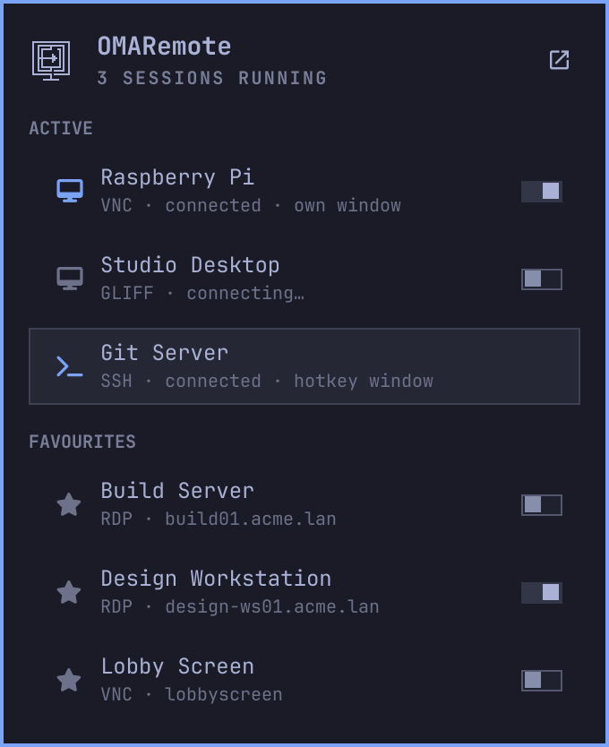

# OMARemote for the Omarchy bar

Your [OMARemote](https://github.com/RFdeGroot/OMARemote) remote desktops (RDP, VNC) and SSH
sessions in the Omarchy bar.
Running sessions and favourite connections are one click away: click a running session to bring
it forward, click a favourite to connect it in a tab. OMARemote starts when it is not open yet.



## Install

```bash
omarchy plugin add https://github.com/RFdeGroot/omarchy-omaremote.git --enable
```

Then place it in the bar from Omarchy's bar settings, if it did not ask where.

Without OMARemote the panel offers to install it: *Install OMARemote* opens a terminal that
downloads the newest release for your machine (Intel/AMD or Apple Silicon), checks that
OMARemote's release key signed it, and installs it with pacman, which also installs everything it
needs. A download without that signature is not installed, and neither is one built against a
newer Qt than your system has (a new release can be ahead of your system): update the system
first with `omarchy update`. The same button updates an OMARemote that is too old for this
plugin: it needs 0.9.11 or newer (0.4.2 keeps connection names and hosts off command lines and out of
desktop notifications, 0.5.1 says which sessions are hotkey windows, 0.5.2 takes in no synced
connection id its command line would read as an option, 0.7.0 keeps its text fields from reading
the clipboard by themselves and bounds what a paste takes in, 0.8.0 keeps synced connection names
from adding options to ssh's configuration, 0.8.2 asks before a synced change shares a drive or the
microphone or moves a connection with a chosen SSH key to another host, 0.9.1 also when a synced
move into another group would do so through that group's settings, 0.9.2 also before a synced
restore from the trash, and gives a new synced connection no group credential set, 0.9.3 also before
a synced group deletion drops a gateway, KDC or security level, and counts the clipboard as
sharing, 0.9.4 keeps session tabs from reading the clipboard unbounded or when it is not
shared, 0.9.5 caps the cursors a server sends, 0.9.6 serves a pasted clipboard file only while it
is still the file that was offered, 0.9.7 keeps a shared sync folder from planting files and never
overwrites a connections file it cannot read, 0.9.10 caps what its updater and update checks
download, in bytes and in time, 0.9.11 also the time its update checks spend on headers and
redirects), and connects nothing through an older one.

The plugin needs nothing beyond Omarchy itself. The install button uses `curl`, `gpgv`, `sudo` and
`pacman`, which Omarchy has; it runs only when you click it, and `sudo` asks for your password in the
terminal it opens.

## Remove

```bash
omarchy plugin remove rfdegroot.omaremote
```

This removes the bar icon only. OMARemote itself stays; remove it with `sudo pacman -R omaremote`
if you no longer want it.

## Use

- **Active**: sessions that are connecting or connected. Click one to bring it forward. A hotkey
  window (a connection OMARemote shows and hides with a shortcut of its own) does what its shortcut
  does: shown and focused, it hides; otherwise it comes forward.
- **Favourites**: connections starred (★) in OMARemote that are not running. Click one to connect
  it.
- **Own window**: the switch on each row (or `w`) sets where that connection opens: off, in its
  tab in OMARemote; on, in a floating window of its own on the workspace you are on. A session in
  a tab moves out of it without reconnecting, and one in its own window comes over to this
  workspace. Running hotkey windows have no switch: they always open on their own workspace.
- The button at the top right opens OMARemote itself; so does a middle click on the bar icon.

| Key | In the panel |
| --- | --- |
| `j` `k`, `↓` `↑` | move |
| `⏎` | open the session or connect the favourite |
| `w` | own window for this connection: on or off |
| `o` | open OMARemote |
| `r` | refresh |
| `i` | install or update OMARemote, when it offers to |
| `esc` | close |

## Settings

**Hide the icon while OMARemote is closed and no session is running** (off by default). With it
on, the icon shows only while OMARemote is open or a session runs (a session in a window of its
own keeps running after OMARemote's window closes). It always shows while OMARemote is missing, so
it can offer to install it.

Which connections open in their own window is saved with the plugin's other settings, so it
stays as you left it, on every monitor.

## How it works

The plugin reads what OMARemote reports and does not keep state of its own:

- `omaremote --version` decides between the list and the install button;
- `omaremote-session paths` says where the connections and the session-change marker live; the
  favourites come from the connections file, the sessions from `omaremote-session list`, and both
  are watched for changes rather than polled;
- a click runs `omaremote open <connection>`, which asks the open OMARemote window (over
  Quickshell IPC) to show the session or connect, or starts OMARemote to do so; with its switch
  on for that connection, `omaremote open --window <connection>`; on a running session that
  `omaremote-session list` marks `hotkey`, `omaremote toggle <connection>`;
- the install button checks the download with `gpgv` against `omaremote-release.gpg`, OMARemote's
  release key (fingerprint `D7FC432CF643656A400BDDEB3BE7753BBB50B393`), and compares the Qt in
  the package's `.BUILDINFO` with the installed `qt6-base`, before `sudo pacman -U`.

## Development

```bash
node --test tests/*.test.js     # the logic: versions, which rows show, their text
omarchy plugin validate .
tests/preview.sh                # redraws preview.png from sample data, in your current theme
```

`PanelBody.qml` is the dropdown's contents, apart from the popup in `Panel.qml`, so the preview
can draw it offscreen from sample data; `Service.qml` reads OMARemote, `Model.js` holds the logic.

## How it is made

The plugin is written with an AI coding assistant ([Claude Code](https://claude.com/claude-code)).
I decide what it does and how, try every change myself, and nothing is released without passing
its tests. Bugs are still mine: please report them.

## License

MIT, see [LICENSE](LICENSE).
